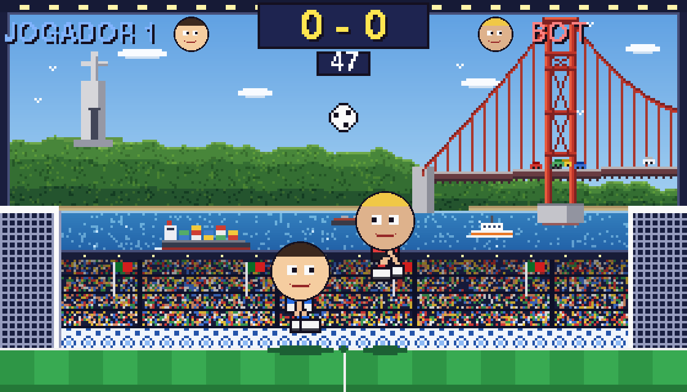
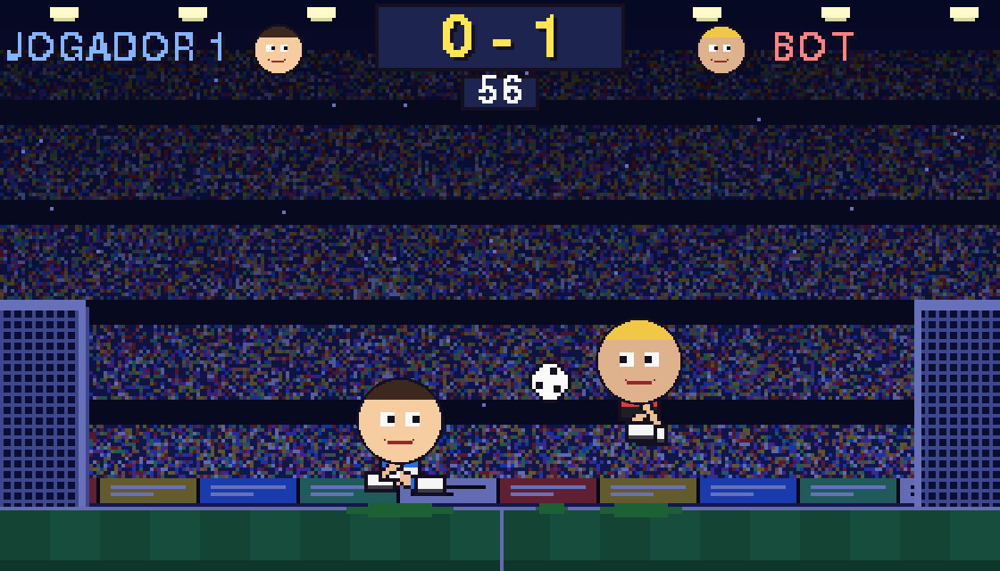
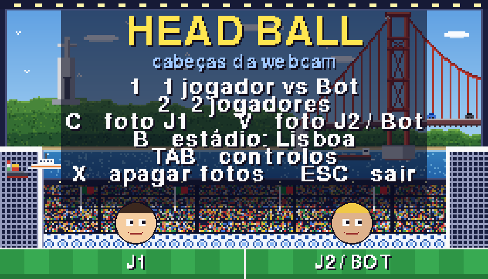
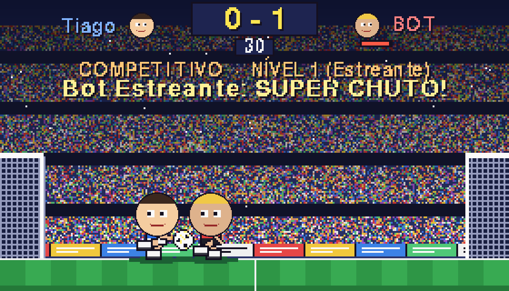
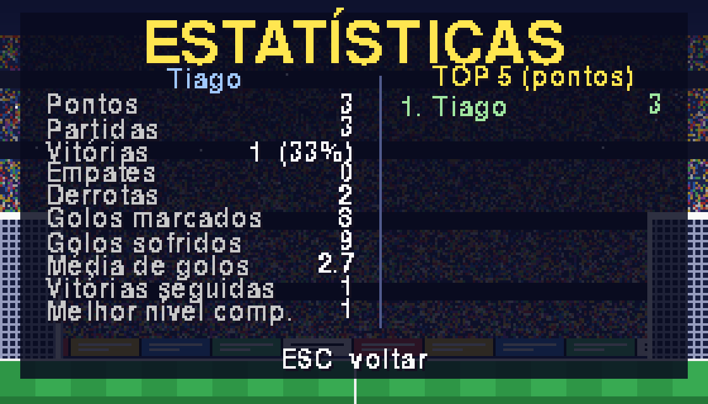
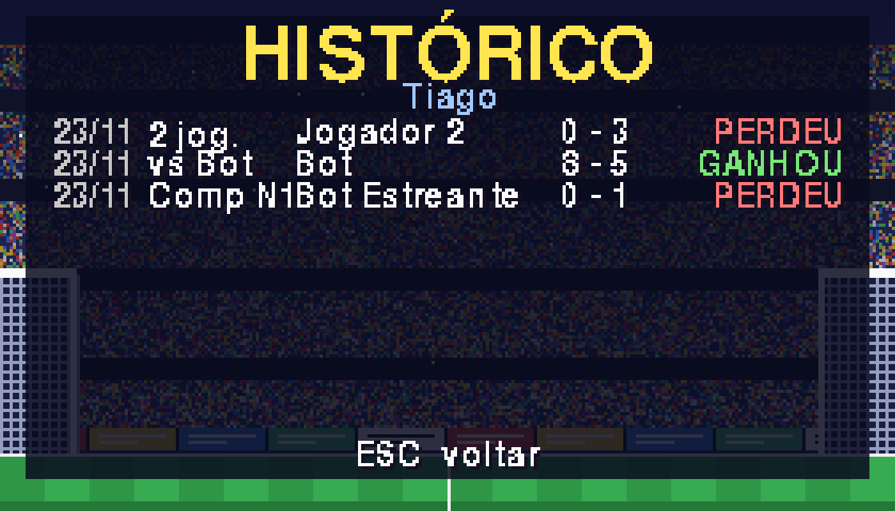

# ⚽ Head Ball Webcam

> Um jogo de futebol 1 contra 1 em pixel art, em que a cabeça de cada jogador é a **tua cara**, tirada pela webcam.
> *A 1v1 pixel-art football game in Python where each player's head is your own face, captured with the webcam.*


Projeto da unidade curricular **Fundamentos de Programação** do CTeSP em Cibersegurança, no Instituto Piaget de Almada (2026/27). Vai ser apresentado na Retro Exposition, a 15 de dezembro de 2026.

## Funcionalidades

- **Contas de jogador:** escolhes um nome e os teus pontos, partidas e estatísticas ficam guardados numa base de dados (SQLite).
- **3 modos:** contra o computador, **2 jogadores** no mesmo teclado e **competitivo** — bots cada vez mais difíceis (Estreante → Lenda) até perderes.
- **Power-ups** durante a partida: velocidade, super chuto, super salto e gelo (congela o adversário).
- **Histórico** das últimas partidas (ganhou / empate / perdeu) e **estatísticas**: vitórias, golos, média, melhor sequência e **top 5**.
- **Cabeças tiradas pela webcam**, com deteção de cara (OpenCV) e pixelização automática. Também é possível usar uma foto que esteja no computador.
- **Física com pernas articuladas**: coxa e canela com molas, remate em chicote e colisões que não deixam a bola atravessar os jogadores.
- **5 estádios**: Clássico, Lisboa (Cristo Rei e Ponte 25 de Abril), Piaget, Almada e Noite, alguns com animações (navios, metro de superfície, gaivotas).
- **Comandos PS5, PS4 e Xbox**, por cabo ou Bluetooth, detetados automaticamente.
- Regra **"bola ao ar"**: se a bola ficar presa entre os dois jogadores durante 3 segundos, é lançada ao ar.

## Estádios

| Lisboa | Almada | Piaget |
|---|---|---|
|  |  |  |
| **Clássico** | **Noite** | **Menu** |
|  |  |  |

| Power-up a meio do jogo | Estatísticas e top 5 | Histórico |
|---|---|---|
|  |  |  |

## Instalação

É preciso ter o **Python 3.10 ou mais recente**.

```bash
py -m pip install -r requirements.txt
py headball_webcam.py
```

**No Linux (por exemplo Linux Mint) ou no macOS** o comando é `python3`, e é preciso um ambiente virtual:

```bash
sudo apt install -y python3-venv python3-tk      # só no Linux, uma vez
python3 -m venv .venv
source .venv/bin/activate
pip install -r requirements.txt
python headball_webcam.py
```

Das próximas vezes basta `source .venv/bin/activate` e `python headball_webcam.py`.

Sem o OpenCV o jogo funciona na mesma, mas sem as fotos da webcam.

## Controlos

| | Jogador 1 | Jogador 2 | Comando |
|---|---|---|---|
| Mover | A / D | ← / → | Analógico ou setas |
| Saltar | W | ↑ | CRUZ |
| Chutar | ESPAÇO | ENTER | QUADRADO, CÍRCULO, R1 ou R2 |

**No menu:** `1` = contra o bot · `2` = 2 jogadores · `3` = competitivo · `H` = histórico · `E` = estatísticas · `N` = mudar de jogador · `B` = estádio · `C` / `V` = foto do J1 / J2 · `X` = apagar as fotos · `TAB` = controlos · `F11` = ecrã inteiro · `ESC` = sair

**No ecrã da webcam:** `TAB` = trocar de câmara · `ESPAÇO` = tirar a foto · `F` = escolher um ficheiro · `ESC` = cancelar

## Privacidade e segurança

- As fotos ficam **só no teu computador**, na pasta `heads/`, e nunca são enviadas para lado nenhum. Apagas com `X` no menu.
- As contas e os resultados ficam **só no teu computador**, em `dados/headball.db` (e uma cópia em texto em `dados/resultados.txt`). Só se guarda o nome que escolheres — nada de emails ou palavras-passe.
- Os nomes são validados (máx. 12 caracteres, só letras, números, espaço, `-` e `_`) e todas as consultas à base de dados usam parâmetros, por isso não há injeção de SQL.
- As pastas `heads/` e `dados/` estão no `.gitignore` e nunca vão parar ao repositório.

## Estrutura

```
headball_webcam.py     jogo: física, bot, partida, estádios, ecrãs
base_dados.py          contas, histórico, estatísticas e ranking (SQLite)
powerups.py            lógica dos power-ups
testes/test_jogo.py    7 casos de teste automáticos
requirements.txt       dependências
docs/
  MAPA_FUNCOES.md      todas as funções: o que recebem, o que devolvem e o que fazem
  NOTA_PROGRESSO_SPRINT1.md
  img/                 capturas de ecrã
```

## Testes

```bash
py -m unittest discover testes -v
```

Testam a validação dos nomes (incluindo uma tentativa de injeção de SQL), as contas, os pontos, as estatísticas, o histórico, o ranking, os power-ups e os níveis do bot — sem abrir a janela do jogo.

## Estado do projeto

O projeto é desenvolvido em sprints (Scrum).

- [x] Sprint 0: ideia, backlog e primeira versão jogável
- [x] Sprint 1: menu com validação, funções e mapa de funções
- [x] Contas, histórico, estatísticas, top 5, power-ups e modo competitivo (adiantado do Sprint 2)
- [x] 7 casos de teste automáticos
- [ ] Sprint 2: separar o resto do código em módulos; tempo real; consentimento antes da foto
- [ ] Sprint 3: multijogador em rede local (LAN), se houver tempo
- [ ] Retro Exposition: 15/12/2026

## Uso de IA

| Ferramenta | Para que foi usada | Como verificámos |
|---|---|---|
| Claude (Anthropic) | Apoio na escrita de partes do código (incluindo a base de dados, os power-ups e o modo competitivo) | Lemos e percebemos o código antes de o integrar, corremos os testes e testámos a jogar |
| Claude (Anthropic) | Deteção e correção de erros (por exemplo, as animações do cenário passavam por cima das balizas) | Aplicámos as correções e testámos o jogo nos 5 estádios |
| Claude (Anthropic) | Apoio na documentação: mapa de funções, nota de progresso e README, feitos a partir do código | Revimos os textos e comparámos o mapa com o código para garantir que não faltava nenhuma função |

A ideia, as decisões de design, os testes e a integração final foram feitos pela equipa.

## Equipa

- **Tiago Costa**
- **André Filipe**
- **Guilherme Lopes**

## Tecnologias

Python 3 · [pygame-ce](https://pyga.me/) · [OpenCV](https://opencv.org/) · NumPy · SQLite

## Licença

[MIT](LICENSE)
