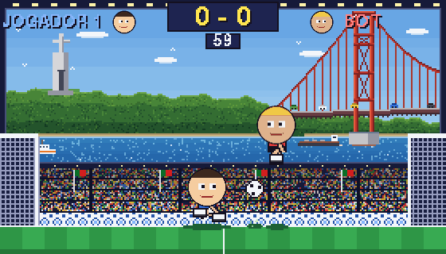
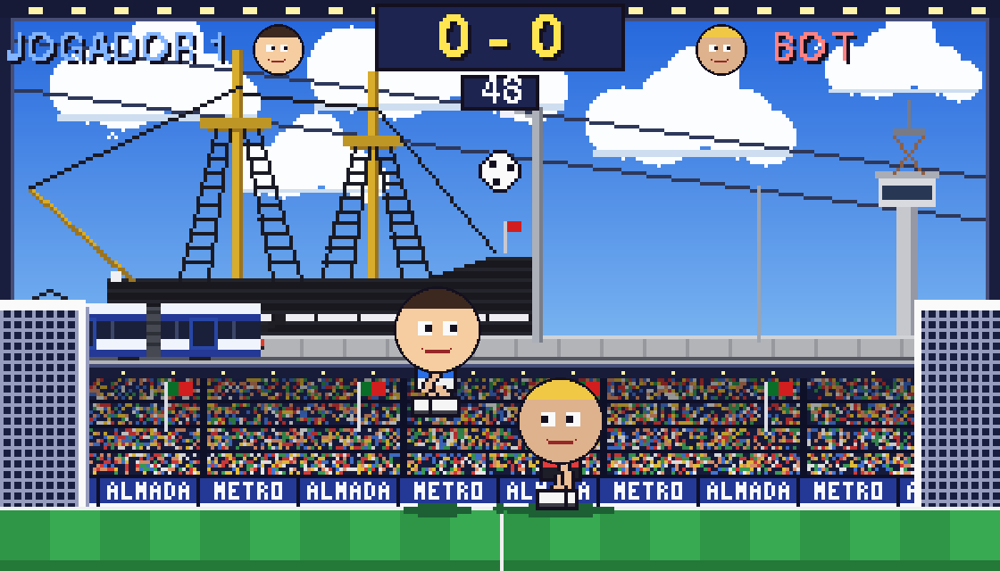
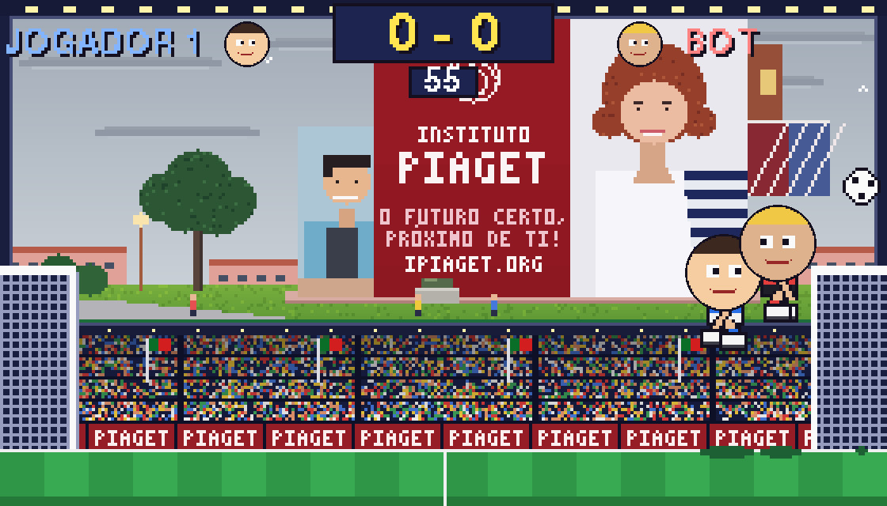
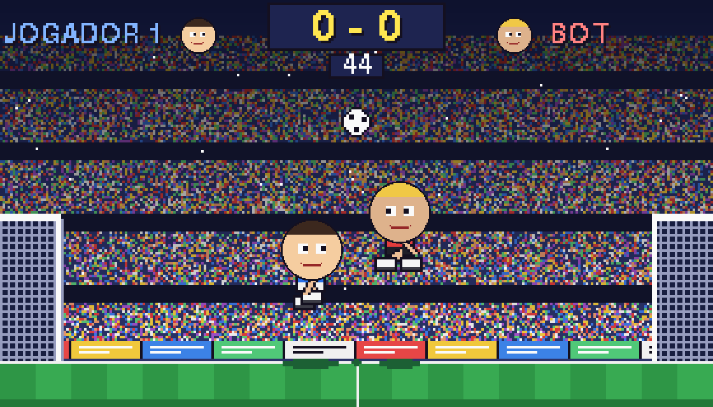

# ⚽ Head Ball Webcam

> Um jogo de futebol 1 contra 1 em pixel art, em que a cabeça de cada jogador é a **tua cara**, tirada pela webcam.
> *A 1v1 pixel-art football game in Python where each player's head is your own face, captured with the webcam.*



Projeto da unidade curricular **Fundamentos de Programação** do CTeSP em Cibersegurança, no Instituto Piaget de Almada (2026/27). Vai ser apresentado na Retro Exposition, a 15 de dezembro de 2026.

## Funcionalidades

- **1 jogador contra o computador** ou **2 jogadores** no mesmo teclado.
- **Cabeças tiradas pela webcam**, com deteção de cara (OpenCV) e pixelização automática. Também é possível usar uma foto que esteja no computador.
- **Física com pernas articuladas**: coxa e canela com molas, remate em chicote e colisões que não deixam a bola atravessar os jogadores.
- **5 estádios**: Clássico, Lisboa (Cristo Rei e Ponte 25 de Abril), Piaget, Almada e Noite, alguns com animações (navios, metro de superfície, gaivotas).
- **Comandos PS5, PS4 e Xbox**, por cabo ou Bluetooth, detetados automaticamente.
- Regra **"bola ao ar"**: se a bola ficar presa entre os dois jogadores durante 3 segundos, é lançada ao ar.

## Estádios

| Lisboa | Almada | Piaget |
|---|---|---|
|  |  |  |
| **Clássico** | **Noite** | **Menu** |
|  |  |  |

## Instalação

É preciso ter o **Python 3.10 ou mais recente**.

```bash
py -m pip install -r requirements.txt
py headball_webcam.py
```

No Linux ou no macOS, usa `python3` em vez de `py`.

Sem o OpenCV o jogo funciona na mesma, mas sem as fotos da webcam.

## Controlos

| | Jogador 1 | Jogador 2 | Comando |
|---|---|---|---|
| Mover | A / D | ← / → | Analógico ou setas |
| Saltar | W | ↑ | CRUZ |
| Chutar | ESPAÇO | ENTER | QUADRADO, CÍRCULO, R1 ou R2 |

**No menu:** `1` = 1 jogador · `2` = 2 jogadores · `B` = mudar de estádio · `C` / `V` = foto do J1 / J2 · `X` = apagar as fotos · `TAB` = controlos · `ESC` = sair

**No ecrã da webcam:** `TAB` = trocar de câmara · `ESPAÇO` = tirar a foto · `F` = escolher um ficheiro · `ESC` = cancelar

## Privacidade

As fotos ficam guardadas **só no teu computador**, na pasta `heads/`, e nunca são enviadas para lado nenhum. Podes apagá-las com a tecla `X` no menu. A pasta `heads/` está no `.gitignore`, por isso nunca vai parar ao repositório.

## Estrutura

```
headball_webcam.py     jogo completo
requirements.txt       dependências
docs/
  MAPA_FUNCOES.md      todas as funções: o que recebem, o que devolvem e o que fazem
  NOTA_PROGRESSO_SPRINT1.md
  img/                 capturas de ecrã
```

## Estado do projeto

O projeto é desenvolvido em sprints (Scrum).

- [x] Sprint 0: ideia, backlog e primeira versão jogável
- [x] Sprint 1: menu com validação, funções e mapa de funções
- [ ] Sprint 2: resultados guardados num ficheiro e top 5; separar o código em módulos
- [ ] Sprint 3: README final e 5 casos de teste
- [ ] Retro Exposition: 15/12/2026

## Uso de IA

| Ferramenta | Para que foi usada | Como verificámos |
|---|---|---|
| Claude (Anthropic) | Apoio na escrita de partes do código do jogo | Lemos e percebemos o código antes de o integrar, e testámos no jogo |
| Claude (Anthropic) | Deteção e correção de erros (por exemplo, as animações do cenário passavam por cima das balizas) | Aplicámos as correções e testámos o jogo nos 5 estádios |
| Claude (Anthropic) | Apoio na documentação: mapa de funções, nota de progresso e README, feitos a partir do código | Revimos os textos e comparámos o mapa com o código para garantir que não faltava nenhuma função |

A ideia, as decisões de design, os testes e a integração final foram feitos pela equipa.

## Equipa

- **Tiago Costa**
- **André Filipe**
- **Guilherme Lopes**

## Tecnologias

Python 3 · [pygame-ce](https://pyga.me/) · [OpenCV](https://opencv.org/) · NumPy

## Licença

[MIT](LICENSE)
